# C 扩展介绍及次要组实验结果

这里保存 C/large（大规模实验）的完整八个分布实验、四个性能实验，以及固定规模的 Python/C 后端对比。

文档图是 C/large 参考数据的静态标本，位于 docs/assets/c-large-2026-10-13-4cd9ad/；运行产物位于 all-outputs/c-large/，其中 jsons/ 保存原始数据、svgs/ 保存运行图。固定规模的后端配对比较另存于 all-outputs/backend-comparison/jsons/backend-comparison.json，不归作 large 规模测量。大规模 JSON 只保留在本地，不纳入 Git；图、说明和小型对比 JSON 可随项目分享。C 实现仍在 `src/merkle_commitment/`，并未回退。

## 密码分布实验

单叶 A/B/C/D 保留为密码学原理演示，树级 A′/B′/C′/D′ 是本方案的主要实验。A′ 沿用原 E 的实现；B′ 检查邻居开封后的公开视图，C′ 实际恢复被孤立的目标，D′ 构造弱化承诺的冲突开封。本节八幅图采用自写 C SHA3 的 large 模式，原始样本、公开材料和攻击见证保存在 [large/distribution.json](../all-outputs/c-large/jsons/distribution.json)。种子 20261012，各类依次加 0–7；种子只控制实验输入。

### 单叶原理演示

#### 实验 A：单叶commit雪崩效应分析

固定 $n=8,i=3$，消息与 nonce 均为 32 B。分别采集两组各 100,000 对输入，每对只改变消息或 nonce 的一个随机位；比较两个叶摘要的汉明距离，并统计每个输出位的翻转频率。这里的单叶 commit 指随机化叶摘要。

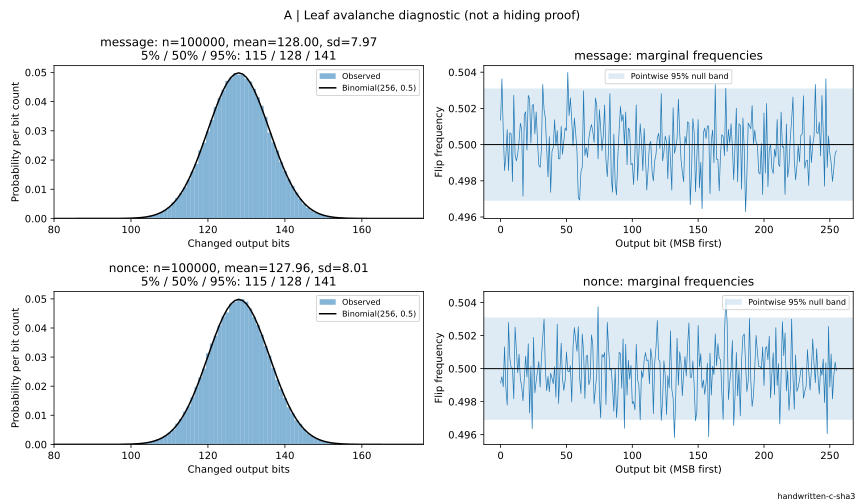

消息位改变后的平均距离为 128.003 位，nonce 位改变后为 127.956 位，标准差分别为 7.973 和 8.007。这与 $\operatorname{Binomial}(256,1/2)$ 的均值 128、标准差 8 相吻合：一次局部输入变化通常改变约一半输出位，而距离集中在 128 周围。图内的 5%、50%、95% 分位数展示这种集中程度，右侧频率曲线则展示扩散覆盖各个输出位。

这说明本实现中的消息和 nonce 都充分参与了叶摘要的混合。对于 Binding，消息改动会产生新的叶摘要，随后由实验 A′ 展示它如何传到承诺；对于 Hiding，nonce 的变化能够重新随机化摘要的外观，实验 B/C 进一步观察这种作用如何隐藏低熵类别、扩大猜测空间。

#### 实验 B：低熵输入类别无偏测试

对单字节消息 0/1 各使用 100,000 个新 nonce，对两种情况下的摘要**逐位**检查该位为 1 的频率，计算两种情况的频率差。

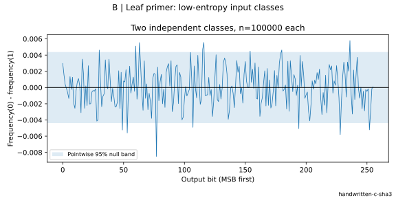

频率差围绕零波动，图中的逐位参考带给出抽样尺度。样本量扩大十倍后，频率差的抽样波动尺度缩小到原来的约 $1/\sqrt{10}$，更容易观察单个输出位上的类别偏向。这是 nonce 随机化外观的直接诊断；树根和开封材料是否继续呈现这种行为，由 B′ 观察。

#### 实验 C：（小模型中的）抗穷举攻击性

十个候选数字配合只有 $t=4,6,8,10,12,14$ 个未知位的 nonce，每档搜索 32 个目标。单图保留首次恢复查询数的箱线分布和均值，完整样本继续保存。

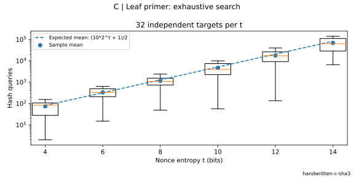

候选空间为 $M=10\cdot2^t$，均匀目标的平均查询数为 $(M+1)/2$。每多一个未知位，搜索空间约翻倍；固定候选预算 $q$ 下，恢复概率为 $\lfloor q\rfloor/M$。树上攻击如何使用这个空间、真实验证会多做多少哈希，由 C′ 量化。

#### 实验 D：投影摘要碰撞测试

保留前 $b=8,12,16,20,24$ 位叶摘要，每档搜索 32 次首次碰撞，用一幅图比较实测分布和生日模型。

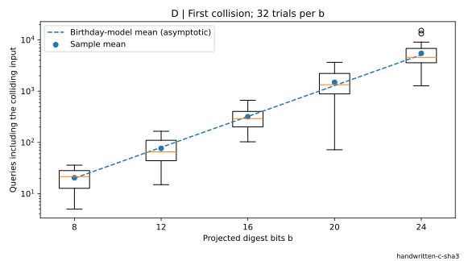

平均查询数为 20.44、76.69、317.31、1491.56、5477.50，呈现约 $2^{b/2}$ 的增长。输出每增加 4 位，典型成本大约乘 4；D′ 将同一原理连接到“同一公开承诺接受两个不同消息”的具体开封事件。

### 树级方案实验

#### 实验 A′：树结构篡改传播分析

构造 $n=8,32,257,1024,16384,65536$ 的树，每规模在同一棵树上对消息改一位、nonce 改一位各采样 1,000 条路径。保持兄弟摘要不变，同时重算原路径和修改后的路径，记录叶、各父层、树根及最终承诺的汉明距离；每规模每类首例还重建全树核对节点变化。

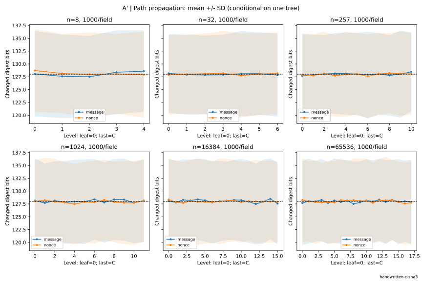

横轴值中，$0$ 是叶节点，$h=\lceil\log_2 n\rceil$ 是树根，特别地用 $h+1$ 表示最终承诺；曲线表示均值，色带表示样本标准差。各层平均距离持续围绕 128 位，而不是随深度逐层增加。每层哈希都把输入差异重新扩散到一个固定的 256 位输出，所以树深增加的是传播步骤，摘要差异保持在同一个统计尺度。

十二次整树核对均显示，每层只有一个节点会改变，其它子树保持原值，局部修改沿唯一祖先路径到达最终承诺。65,536 叶时，合并两类样本后的各层均值仍在 127.77–128.28 位之间，而不是随树深累积。这反映了单项验证只需 $O(\log n)$ 个兄弟摘要的结构原因。对于 Binding，攻击者要保留原承诺，就必须让这条变化链在某处与原链汇合（该处差异为 $0$），从而产生碰撞；扩大树规模仅改变路径长度，哈希输出宽度才决定每次汇合的密码学门槛。

#### 实验 B′：邻居开封后的隐藏性观察

> **场景：** 现把位置 2 的消息藏起来，但公开位置 3。为了验证位置 3，证明必须交出它的兄弟摘要——恰好是位置 2 的完整叶哈希。现在攻击者握着这个哈希，要判断位置 2 是“0”还是“1”；攻击者仍没有位置 2 独立的 32 B nonce。本实验检查的正是这种比只公开树根更强的观察条件。

取 $n=3,8,9$，每规模对 0/1 两类各建 10,000 棵树。两个挑战**只改变一条目标消息为 0/1**；其余消息和该对中的其它 nonce 相同，目标 nonce 分别新采样；对于所观察的摘要，对其每一位，计算目标消息为 0/1 的两类情况下该位等于 1 的频率差。$n=8,9$ 时目标/邻居为 2/3，$n=3$ 时为 0/1；邻居始终是真实叶。

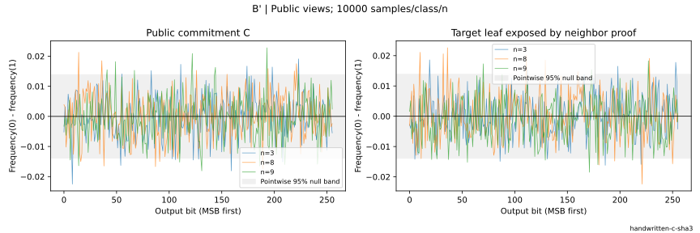

左图中，所观察的摘要是最终承诺 $C$；右图中，观察从邻居的证明中读出的目标叶摘要。每条记录保存 $C$、邻居消息和完整邻居证明；程序核对证明的首个兄弟确实等于目标叶。两类逐位频率差的波动尺度约为 $1/\sqrt{s}$，所以树级图的参考带随各类样本量设定。

这把 Hiding 放进实际公开接口：开封邻居提供了更多材料，但没有公开目标 nonce。树根合成和合法证明中的摘要都参与观察，避免只从单个叶的扩散推断整个公开视图。图比较的是这些逐位指标，安全模型中的未知 nonce 则解释了攻击者为何仍要扩大猜测空间。

#### 实验 C′：其它叶全部开封后的目标恢复

> **场景：只剩一个秘密。** 整棵树已经建好，公开承诺也发出去了，除了目标以外的所有消息都合法开封。目标被孤立，攻击者拿着承诺 $C$ 和所有其它开封材料开始枚举。本实验让攻击者分别走完整验证路径、直接匹配已暴露的目标叶摘要，比较这两种真实攻击。

取 $n=3,8,9$、$t=4,6,8,10,12$，每组合 16 个独立目标。目标候选为十个数字，nonce 字段仍为 32 B，仅低 t 位未知。程序从邻居的公开证明取得目标叶摘要，从公开邻居消息及 nonce 计算另一侧叶，再组装目标的兄弟路径；攻击入口没有取得目标私有 nonce。

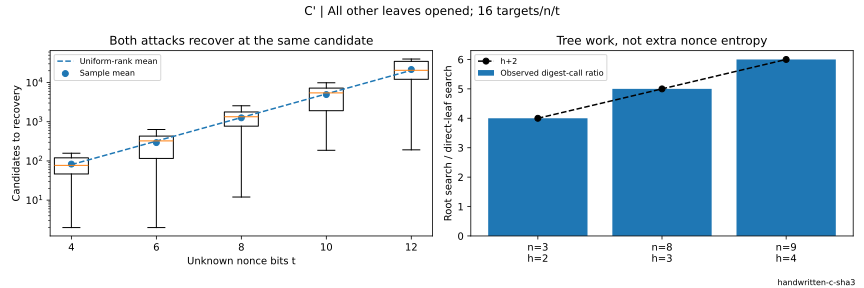

走根搜索逐候选调用正式 verify；直接搜索只计算叶摘要。两种算法都实际运行，并核对在同一个候选处恢复原消息与 nonce。左图汇总首次恢复候选数，理论均值仍为 $(10\cdot2^t+1)/2$：公开其它叶没有改变目标 nonce 的未知位数。

右图比较包装 H 得到的实际调用数，走根搜索与直接叶匹配之比为 $h+2$，三种树形分别为 4、5、6。这个差异来自每个候选的叶哈希、h 层父节点和最终封装。Hiding 的指数门槛来自 nonce 熵；增加树深只提高走根这条搜索路径的工作量，观察者取得目标叶摘要后还能选用较便宜的直接匹配。

本图共实际恢复 240 个目标，两种攻击合计执行 8,045,177 次哈希；原始目标和全部其它开封材料均保留。C 后端使更大的枚举实验可实际完成，但不改变两种攻击的候选顺序和计数含义。

#### 实验 D′：投影下的公开承诺碰撞测试

> **场景：** 固定同一个位置、其它消息和所有 nonce，只改变消息。把最终公开承诺缩成前 $b$ 位。攻击者锁定同一个位置，在不改变其他节点的情况下，寻找两个完全不同的消息（产生两份仅消息不同的 Openning），使其得到相同承诺前缀。实验仅弱化了公开承诺 $C$ 的宽度，各节点内部仍计算完整 SHA3-256。

取 $n=3,8,9$、$b=8,12,16,20$，每组合 32 次搜索。候选消息递增，保证消息不同；复用已保存的兄弟摘要，每次只重算目标路径。公开教学承诺为 $(n,\operatorname{prefix}_b(C))$，教学验证器由完整开封重建整树后比较这个前缀。

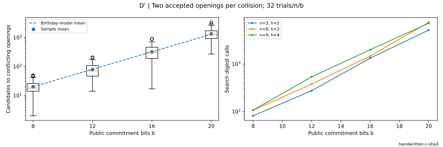

每次碰撞保存两份完整的字节开封和两个完整 $C$，并实际核对：两份开封都被同一个短承诺接受；若恢复正式 256 位承诺，第二份开封被 verify_all 拒绝。这样，碰撞记录直接对应 Binding 的失败事件，而不仅是一对抽象摘要。

本次 $n=8,b=20$ 的一条实际记录在第 1143 个候选处发现冲突：“589”和“1142”得到相同的 20 位公开承诺，两份完整开封都被教学验证器接受。完整的 256 位 $C$ 不同，所以正式验证器可以区分这两个开封；两份字节开封保留在 JSON 中。

左图观察首次冲突开封的候选数，增长尺度仍为 $2^{b/2}$；右图观察实际搜索哈希数，每个候选消耗 $h+2$ 次哈希。输出宽度决定生日攻击门槛，树深决定重算路径的成本。本实现保留 256 位 $C$，前面的碰撞归约把改口门槛连接到完整哈希输出。

## 实现开销实验

本节 P1–P4 全部使用自写 C SHA3 的 large 模式；时间记录保存在 all-outputs/c-large/jsons/，不与原 Python 数据混合。每项操作预热一次，用 pilot 校准 batch 至约 0.2 s，P1–P3 采集九组“秒/调用”，P4 的 k<64 采集九组、其余三组；图展示中位数和四分位区间，JSON 保留全部逐组值和 batch。输入及证明准备在计时区间外，哈希工作量在单独一次调用中统计。

### 性能实验 P1：SHA3 分块边界开销

对预先构造好的全 a 字节串计算 32 B 摘要，长度取 0、32、64、4096、65,536、1,048,576 B，以及 130–142、266–278 B 两个逐字节窗口。计时包含填充、吸收、置换和输出。

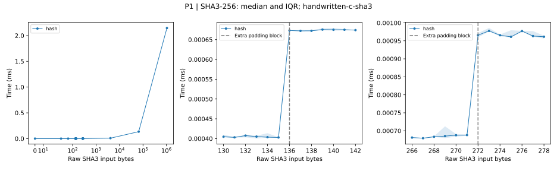

135→136 B 时，中位耗时从 0.403 μs 增至 0.673 μs；271→272 B 时从 0.688 μs 增至 0.966 μs。两处分别对应置换次数 1→2、2→3：输入恰好占满 136 B 的 rate 后，填充还需要一个块。每增加一块约多 0.27–0.28 μs；完整调用还含固定的参数处理和输出成本，因此时间倍率小于单纯的块数倍率。

长输入的工作量为 $\lfloor\ell/136\rfloor+1$ 次置换：4096 B 的 31 次耗时 8.85 μs，64 KiB 的 482 次耗时 135.15 μs，1 MiB 的 7,711 次耗时 2.146 ms。长输入中固定调用成本被分摊，时间主要随处理块数增长。局部阶梯与全局增长共同解释 P3 中叶编码跨块后的开销。

### 性能实验 P2：树规模对建树、开封与验证的影响

每条消息为 32 B，前 8 B 编码位置、后 24 B 为 x。规模取 $n=1$ 及 $2^d-1,2^d,2^d+1$，其中 $d=3,5,7,8,9,10,11,12,13,14,15,16$，最大为 65,537；每棵树预先生成首、中、末及至多 13 个随机位置的证明，计时时循环使用。

commit 包含消息规范化、nonce 生成、全部哈希和树层保存；open 在已有树上读取消息、收集路径并构造证明；verify 使用已有证明重算叶和路径；verify_all 重建全树。验证使用对象入口，open 返回已有消息引用与证明。

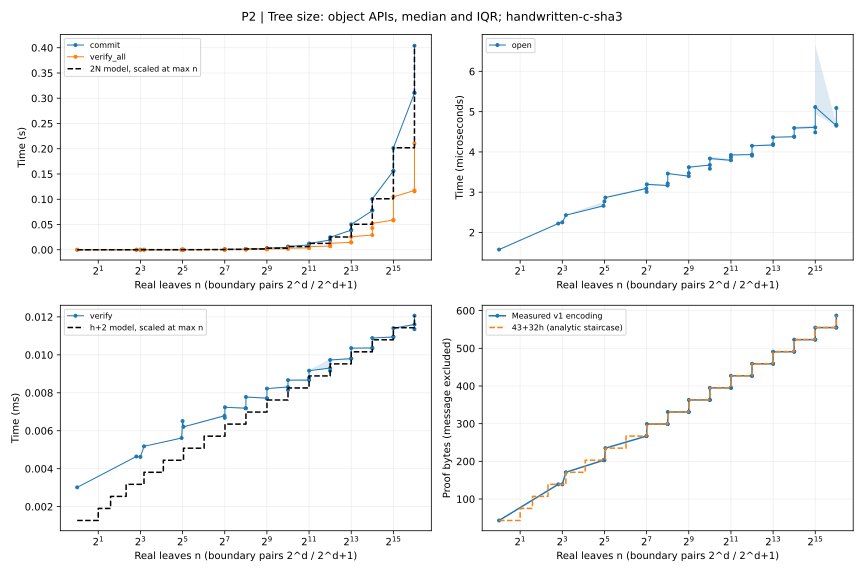

commit 和 verify_all 都需 $2N$ 次哈希，随补齐容量 $N$ 增长，整体为 $O(n)$。1024→1025 时建树从 4.844 ms 增到 6.316 ms，4096→4097 时从 19.261 ms 增到 24.773 ms；65,536→65,537 时从 310.870 ms 增到 403.863 ms。边界处容量和哈希次数仍翻倍，但总时间不严格翻倍：新增部分主要是无需生成 nonce 的占位叶，真实叶与占位叶的编码成本也不同。C 加速哈希后，这些未迁移的 Python 工作和随机源成本在总时间中更明显。

open 和 verify 的增长缓得多：只处理深度 $h=\lceil\log_2 n\rceil$ 的一条路径。65,536 叶时，open 约 4.67 μs，verify 约 11.35 μs；前者只收集已有兄弟摘要，后者执行 $h+2=18$ 次哈希。与 4096 叶的 3.91/9.15 μs 相比，树规模扩大 16 倍只多四层路径，单项接口成本仍很小。完整验证则从 7.19 ms 增到 115.54 ms，体现了全树处理与单路径处理的差别；建树还生成新 nonce，因此比复用 nonce 的完整验证更慢。

证明编码恰为 $43+32h$ B，规模翻倍仅多一个 32 B 兄弟摘要。树使完整列表的绑定承诺可以通过对数大小的材料验证一个位置，而不必把整组消息交给验证者。图中的时间参考线按最大规模归一化，字节阶梯则由编码公式直接给出。逻辑存储为 $(2N-1)\cdot32+32n+\sum_i|m_i|$ B，计入节点摘要、nonce 和消息载荷。

### 性能实验 P3：消息长度对建树、开封与验证的影响

固定 $n=N=32$，消息为全 x 字节串。全局长度取 0、16、32、64、128、256、512、1024、4096、65,536、1,048,576 B，局部逐字节采样 70–86、206–222 B。叶输入比消息多 57 B，所以新的填充块出现在消息长度 79、215 B。

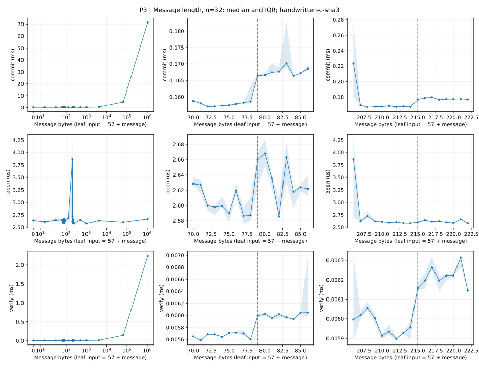

78→79 B 时，commit 从 158.57 μs 增至 166.41 μs，verify 从 5.60 μs 增至 5.99 μs。若叶输入需 $p=\lfloor(57+|m|)/136\rfloor+1$ 次置换，整棵树需 $32p+32$ 次，单项验证需 $p+6$ 次。跨第一个边界时，置换数分别从 64 增为 96、从 7 增为 8，而总时间仅增加约 4.9% 和 7.0%。C 把新增置换压得很短；建树仍包含 nonce 生成、编码和对象构造，单项验证也保留接口检查，所以不能把置换数的倍率直接当作总时间倍率。

214→215 B 时，commit 从 167.06 μs 增至 176.55 μs，verify 从 5.96 μs 增至 6.16 μs；新增的 32 次叶置换在建树中增加约 9.49 μs，单项验证只增加一次叶置换。长消息主要增加叶摘要的计算成本，固定长度的父节点成本保持不变，因而建树处理的新增工作更多。open 仍约为 2.6–2.7 μs，反映它读取已有消息引用和路径的接口行为，不随消息载荷重新做哈希。

这把安全设计与实现成本联系起来：nonce、数量、索引和长度字段共同构成无歧义的随机化叶输入，其 57 B 固定开销也决定了具体的分块边界。4096 B 消息下建树约 0.435 ms、单项验证约 14.28 μs；1 MiB 消息下分别为 71.452 ms 和 2.237 ms，约相差 32 倍。长消息使叶哈希成为主项，整树的 32 个叶与单项验证的一个叶因而呈现清晰的工作量比例。

### 性能实验 P4：共享路径的证明大小与计算成本

固定一棵 65,536 叶的树，每条消息 32 B。开封数量 k 从 1 增至 65,536，比较随机起点的连续区间、均匀分散和随机无重复位置。连续与随机每档采集 32 个实际证明结构，分散位置只有一个确定结构；完整集合端点三类共用一次。

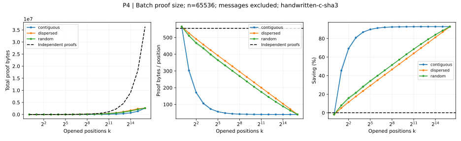

大小以真实批量编码和单点编码公式比较，均不含消息与公共承诺。连续位置更容易共享父节点，分散位置需要更多边界材料；批量证明中 k 个索引和 nonce 始终逐项保留。k=1 时批量编码多 10 B，k=65,536 时没有兄弟摘要，但仍有 2,621,453 B 的索引、nonce 和字段，单点证明为 36,372,480 B。

读大小图时，左图纵轴为一个 k-batch 证明的总字节，中图纵轴为每个开封位置分摊的字节，右图纵轴为相对单点方案的节省比例。单点证明逐份重复携带路径，每位置大小保持不变；批量方案随共享增加而降低每位置成本。连续位置最早获得这种收益。只有一个位置时尚无共享，批量格式的额外字段反而略大；开封全部位置后，三种分布成为同一个集合，曲线汇合。

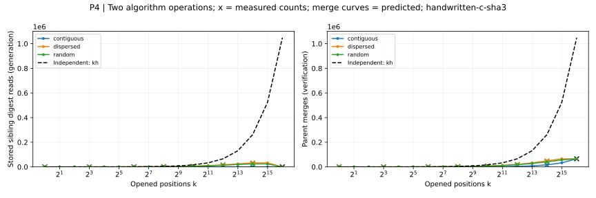

左图统计证明时的 `level[position]` 访问次数，每取一次已保存兄弟摘要就记一次，包含单点证明重复取同一位置的情况；右图统计合并函数 `_parent_hash` 调用次数。这两个指标分别解释材料取用和共同祖先的重复计算。结构分布曲线给出中位数与四分位范围，父合并曲线由实际结构预测，叉号为真实执行计数。

单点方案的两项次数都是 kh；批量分别为 s 与 $k+s-1$。完整端点从 1,048,576 次重复摘要取用降为零，从 1,048,576 次父合并降为 65,535 次；验证总哈希则从 1,179,648 次降为 131,072 次。读取为零只表示无须携带边界摘要，索引、nonce 和集合处理仍有成本。

操作量图中，单点方案随 k 线性增加，因为每份证明都重新走完整路径。批量方案只处理一次共同祖先。兄弟摘要读取曲线可以先升后降：小集合扩张时会接触更多边界，但集合接近整棵树时，原先需要证明提供的边界节点已能从已开封叶子重建，最终无须读取任何兄弟摘要。这不是验证工作归零；右图仍需合并整棵树的 65,535 个父节点。

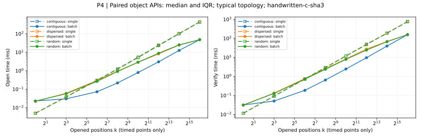

计时比较 k 次 open 与一次 open_many、k 次 verify 与一次 verify_many，使用对象入口，排除建树、编码和准备证明。连续与随机在 32 个结构样本中选择中位兄弟数的固定输入，分散使用确定输入；选择发生在计时之前。本次计时 k=1、8、64、256、1024、4096、16384、65536，k<64 时九组，其余三组，图上只画这八档实测点及批间 IQR。

读时间图时，蓝、橙、绿分别表示连续、分散、随机位置；同色的长虚线与空心方块是单点证明，实线与实心圆是批量证明。比较同色两条线即可看出相同位置集合的批量收益。横轴按 2 的幂刻度排列开封数量，两个纵轴都使用毫秒及对数刻度，等距表示相同的耗时倍率，而不是相同的毫秒增量。阴影是重复计时的四分位范围，表示运行波动，而不是位置分布的差异；连线只连接八档实测点。

右图中，三条单点验证曲线接近重合，因为同样的 k 和树高意味着近乎相同的哈希工作量。批量验证则随位置分布分开：连续位置共享低层父节点最多，曲线最低；分散位置更晚汇合，需要重建更多父节点，曲线最高。随着 k 增加，共享路径使批量验证体现收益；到全量集合时，三种分布成为同一个集合，曲线汇合。左图展示材料读取和对象构造，不重新计算哈希；C 缩短了验证的密码计算，但没有缩短这些 Python 工作，因此两阶段不再相差多个数量级。k=1 的批量生成约 22–23 μs、验证约 30–32 μs，均慢于单点方案约 5/11–12 μs；对数纵轴使这种没有共享、只有协调成本的小集合现象也能看见。

摘要读取减少与父合并减少解释共享收益；集合和排序成本也包含在真实时间中，所以生成开销不会严格按材料数量缩放。本图对应 C/large，共保留 1,041 个结构样本、22 组位置条件的配对计时及 22 组真实操作计数；这里“位置条件”不是计时器的重复组数。完整端点实际计数后也进行正式重复计时。原始结构、真实计数和时间分别保存在 [large/batchproof-performance.json](../all-outputs/c-large/jsons/batchproof-performance.json)。

本次 k=256 时，连续、分散、随机位置的批量验证中位耗时分别为 0.648、2.542、2.377 ms，对应单点验证为 2.944、2.885、2.939 ms，约加速 4.54、1.13、1.24 倍。连续位置共享更多低层父节点，收益最明显；分散与随机需要更多边界，同时支付集合和排序成本。全量开封的批量生成为 48.02 ms，单点为 434.39 ms；批量验证为 156.94 ms，单点为 763.42 ms，分别约快 9.05、4.86 倍。哈希调用数减少九倍而时间没有同倍率减少，量化了未迁移到 C 的 Python 协调成本。

### 结果与复现

八个分布实验及四个性能实验的运行产物保存在 all-outputs/c-large/，本篇只引用 docs/assets/c-large-2026-10-13-4cd9ad/ 中已保存的十四幅静态图。Python 教学参考使用另一组快照，两组不混放；固定规模的 Python/C 对比也是独立测量，不能与不同规模的时间直接相除。两个脚本统一使用 `--scale quick|mid|large`，两种语言均默认 mid；下方提供本组 large 的专用运行和只读重绘命令。

各实验类的 #! 注释注明实际参数范围。large 的 A/B 每组 100,000 个样本，C 搜索到 t=14、每档 32 个目标，D 投影到 b=24、每档 32 次碰撞，A′ 到 65,536 叶；B′ 每规模每类 10,000 样本，C′ 到 t=12、每组合 16 个目标，D′ 到 b=20、每组合 32 次。树级攻击继续使用 n=3/8/9，由 A′ 和性能实验承担大树观测，避免把候选空间与树深的影响混在一起。

性能 large 的 P1/P3 在原局部边界之外增加 64 KiB、1 MiB；P2 增加 d=13–16 的二次幂前后档位，最大 n=65,537、补齐容量 131,072；P4 使用 N=65,536、连续/随机各 32 个结构样本，计时 k=1/8/64/256/1024/4096/16384/65536。C 不加速结构采样和 JSON，因此 P4 控制结构重复数；正式计时精度不变。仅各正式组的目标预算合计约 11 分钟，尚未计预热和制备，不应把 C 的单次加速误读为整套脚本只需几秒。

### 已实现：自写 C SHA3 后端，扩大实验的可运行范围

原 Python 代码的性能受限，不便对稍大的 n 开展实验。主要的瓶颈是**哈希置换**而非树的位置管理。本机以 256 条 32 B 消息建树的 `cProfile` 剖析记录为例，总耗时约 0.422 s，512 次 `sha3_256_digest` 累计占 99.3%，其中 `_keccak_f1600` 占总耗时 94.2%。这两个比例是包含关系，不能相加。这个结论针对建树和密码验证（开封只读取已保存的树节点，不调用哈希，上述比例无意义）。

Keccak 每次置换执行 24 轮，每轮反复处理 25 个 64 位字。当前 Python 版本每次置换调用 720 次 `_rotl64`，上述建树共调用 368,640 次。移位、异或、掩码在 Python 中是解释器执行的整数对象运算，伴随临时对象、函数调用和多层列表索引；每轮还创建中间数组。在 C 中，这些工作可以用固定大小的 `uint64_t` 数组和编译后的机器整数运算完成，省去逐项解释和大量对象操作。树越大，叶哈希与父哈希越多，这个常数开销便被反复放大。

`_sha3_c.c` 实现完整 SHA3-256：rate 136 B、SHA3 后缀 0x06/0x80、24 轮置换及 32 B 输出；不是 Keccak-256。它直接读取 bytes，只有尾块使用局部缓冲，以逐字节 little-endian 读取避免对齐及 aliasing 问题，rotation=0 避免移位 64 位。第一版保持 GIL，不引入 native 树对象或其它 FFI。

`MTC_SHA3_BACKEND=python|c` 在导入时直接绑定公开 digest 和 tree.H，Python 参考实现保留；C 不可加载时直接报错。构建遵循 setuptools 与本机 Python 的设置，实测编译器为 Apple LLVM 21.0.0（clang-2100.1.1.101），使用 -O3、-std=c11；产物为 CPython 3.9 的 arm64/x86_64 universal bundle，没有手工链接 libpython。实际编译身份和选项来自 extension 的 BUILD_INFO，随 C 结果保存。

两个后端均通过六项正确性检查。独立工具在 n=1024、32 B 消息、连续 k=64 的固定条件下测得 commit 中位耗时从 1.346 s 降到 4.924 ms（约 273 倍），verify_many 从 76.910 ms 降到 0.163 ms（约 473 倍）；两端哈希次数分别保持 2,048 和 132。open_many 不调用哈希，约 60/62 μs 的结果基本不变。五组计时、具体样本和编译信息见 [backend-comparison.json](../all-outputs/backend-comparison/jsons/backend-comparison.json)。

每个 digest 只跨一次 Python/C 接口，binding 与 bytes 输出成本已经包含在上述结果中，当前并未妨碍建树和验证获得明显加速。没有单独测量空 binding，不能给出精确的调用开销比例；长输入在 C 内重复处理多个块，不会逐轮跨语言调用，固定接口成本得到分摊。

C 后端改变的是相同算法的执行成本，不改变 Binding/Hiding 的参数或依据。后端和规模是独立维度，正式 Python 采样预计超过 90 s 时须启动前确认，C 默认也不扩大到 large；P4 的摘要读取次数、父合并次数及证明字节数保持原定义。本次已完成 C/large 的八个分布与四个性能实验，并重绘十四幅图；测量没有更改树接口、证明格式或指标定义。

## 如何理解与主展示的差别

C 缩短的是哈希计算，没有缩短 nonce 生成、Python 编码、集合和对象处理。因此 P2 的容量翻倍不再表现为总时间近乎翻倍，P3 的填充阶跃也更小；这属于瓶颈转移，不是算法失去原有工作量规律。P1 的两个阶跃仍然清楚，八个密码分布实验没有整体变差；单叶 D 的重复数从 100 降为 32，均值的抽样波动反而更大。

本次 C/large 与主展示的 Python/mid 不只有后端不同，树规模和重复数也不同，不能直接相除宣称后端加速。真正的配对比较是 `all-outputs/backend-comparison/jsons/backend-comparison.json` 中固定 n=1024、k=64 的两端结果。k=1 的批量验证比单点更慢，分散的小集合收益也有限，这些结果完整保留。

### 噪声记录

以下是本次全部相对 IQR（IQR/中位数）达到 10% 的时间点。这个阈值只是统一筛查口径，不是统计显著性检验；没有删除点、平滑曲线或挑选重跑结果。

| 实验 | 参数与操作 | 相对 IQR |
| --- | --- | ---: |
| P2 | n=32，verify | 14.6% |
| P2 | n=1024，verify_all | 57.0% |
| P2 | n=16384，verify_all | 29.6% |
| P2 | n=32769，open | 33.7% |
| P3 | 86 B，verify | 17.0% |
| P3 | 206 B，commit | 43.5% |
| P3 | 206 B，open | 41.0% |
| P4 | k=16384，分散位置 single_verify | 10.3% |

P2 的 n=1024、16384 完整验证点偏高，分别压小了紧随其后的容量阶跃。P3 的 206 B 在同块窗口内异常偏高，连不做哈希的 open 也变慢，不能将它解释为 SHA3 填充效应。现有记录不能进一步确认具体的运行时或系统干扰来源。

## 复现与重绘

以下命令在项目根目录运行。默认运行产物进入 all-outputs/<后端>-<规模>/，这里显式写出路径便于核对。docs/assets/ 是保存的文档快照，不应当作采样或重绘的默认输出目录。

```sh
MTC_SHA3_BACKEND=c PYTHONPATH=src .venv/bin/python -B experiments/distribution.py --scale large --output-dir all-outputs/c-large/jsons --figure-dir all-outputs/c-large/svgs
MTC_SHA3_BACKEND=c PYTHONPATH=src .venv/bin/python -B experiments/performance.py --scale large --output-dir all-outputs/c-large/jsons --figure-dir all-outputs/c-large/svgs
```

已有数据时只重绘，不重新采样或计时：

```sh
PYTHONPATH=src .venv/bin/python -B experiments/distribution.py --from-json all-outputs/c-large/jsons/distribution.json --figure-dir all-outputs/c-large/svgs
PYTHONPATH=src .venv/bin/python -B experiments/performance.py --from-json all-outputs/c-large/jsons/performance.json --figure-dir all-outputs/c-large/svgs
PYTHONPATH=src .venv/bin/python -B experiments/performance.py --batchproof-only --from-json all-outputs/c-large/jsons/batchproof-performance.json --figure-dir all-outputs/c-large/svgs
```

`PYTHONPATH=src .venv/bin/python -B tools/compare_backends.py` 只运行固定规模比较，默认保存到 `all-outputs/backend-comparison/jsons/backend-comparison.json`；它不参与两套实验的主入口。
