# 随机化 Merkle Tree Commitment 方案

**承诺的核心是先固定内容，之后再允许别人验证内容。** 承诺方首先发布一个简短摘要；需要公开内容时，再提交消息和相应的验证材料，这一步称为“开封”。一个承诺方案需要同时满足两个目标：binding（绑定性）保证承诺方不能在发布摘要后改口，hiding（隐藏性）保证其它人无法仅凭承诺猜出尚未公开的消息。

本方案用于承诺一组按顺序排列的消息。它先为每条消息生成叶子摘要，再用 Merkle 树把这些摘要逐层合成为一个树根。因此，承诺方既可以一次开封全部消息，也可以只开封某个位置。每个位置都使用一个独立的 32 字节随机值，底层哈希函数是本项目手写实现的 SHA3-256。

**哈希函数**把任意长度的字节串映射为固定长度的摘要；本方案的摘要长度为 32 字节。相同输入总会得到相同摘要。Merkle 树的真实叶子保存各条消息对应的摘要，内部节点则保存其左右两个子节点摘要合并后的摘要。

## 从三个消息看完整流程

假设承诺方要固定三个消息：位置 $0$ 是“6”，位置 $1$ 是“9”，位置 $2$ 是“0”。索引从 $0$ 开始；即使相同内容出现在不同位置，也仍然可以按位置分别验证。

- **发布承诺。** 承诺方为三个位置分别生成随机值，将每条消息与对应随机值编码成叶子摘要，然后逐层合并。最后，承诺方公开真实消息数量 $3$ 和承诺摘要 $C$，并在本地保存消息、随机值和树的各层节点。
- **开封位置 $2$。** 承诺方交出消息“0”、位置 $2$ 的随机值，以及从该叶子走到树根时每一层所需的兄弟摘要。
- **验证开封。** 验证者利用这些材料重新计算承诺摘要，并与此前保存的 $C$ 比较。二者一致，说明这个位置上的消息与发布承诺时固定的内容一致。

三个叶子无法在每一层都两两配对，因此需要补入占位叶 $P_3$。下面用 $L_0,L_1,L_2$ 表示三个真实叶子，用 $A_0,A_1$ 表示它们的父节点，用 $T$ 表示树根。最终承诺摘要 $C$ 还会把真实消息数量 $3$ 与 $T$ 一起哈希。

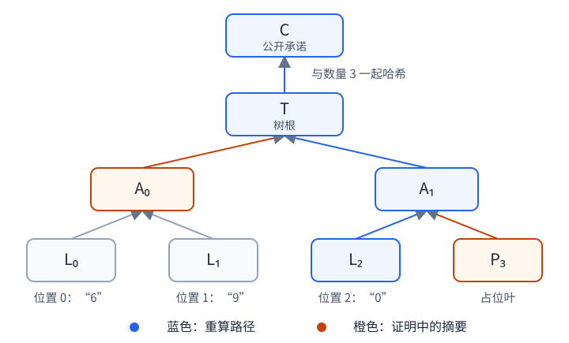

图中的橙色节点是证明中需要提供的摘要，即 $P_3$ 和 $A_0$。验证者先重新计算 $L_2$，将它与右侧的 $P_3$ 合成为 $A_1$，再把 $A_1$ 与左侧的 $A_0$ 合成为树根 $T$，最后由 $T$ 得到承诺摘要 $C$。**认证路径**就是这样一组从叶子通往树根的兄弟摘要；借助它，验证者无须取得整棵树。开封位置 $2$ 时只会公开该位置的随机值，其它位置的随机值仍由承诺方保存。

> 验证者必须把重算结果与此前保存的承诺进行比较。正是“先保存承诺，后检查开封”的时间顺序，使验证结果能够说明内容没有在事后被更改。完整开封则会交出全部消息和随机值，让验证者重建整棵树。

## 设计选择与精确定义

**按位置承诺。** 输入是一个非空的有序消息列表，真实消息数量记为 $n$。消息在内部统一表示为字节串；字符串先按 UTF-8 编码，因此同一编码结果的字符串和字节串表示同一条消息。索引从 $0$ 开始，数量和索引都使用 8 字节无符号整数表示。

**每个叶子独立随机化。** 如果公开的叶子摘要直接由“0”到“9”这类低熵消息计算得到，攻击者只需计算十次哈希，就能把摘要与候选逐一比对。公开的固定盐也不能解决这个问题，因为攻击者同样可以把它加入每次候选计算。本方案每次承诺时都通过 `secrets.token_bytes` 从操作系统取得新的随机字节，并为每个位置生成独立的 32 字节随机值 $r_i$。单项开封只公开被开位置对应的 $r_i$。

**让每类哈希输入都有唯一解释。** 不同类型的节点使用不同前缀，真实消息还会编码消息总数、当前位置和消息长度。这样既能明确划分字段边界，也能把内容与其位置、所属列表长度一起绑定。这种做法称为域分隔；其原则可参考 [RFC 9162 的 Merkle 树定义](https://www.rfc-editor.org/rfc/rfc9162.html#section-2.1)，下表则给出本方案自己的输入格式。

用 $H$ 表示手写 SHA3-256，用 $\operatorname{U64}(x)$ 表示整数 $x$ 的 8 字节大端编码，即高位字节在前。各字段按照表中顺序拼接后再交给 $H$。`0x00` 等前缀均为**一个字节**；参与计算的是原始的 32 字节摘要，而不是摘要的十六进制文本。位置 $i$ 的消息和随机值分别记为 $m_i$ 和 $r_i$，消息的字节数记为 $|m_i|$。

| 节点或输出 | 交给 $H$ 的字段 |
| --- | --- |
| 真实叶子 $L_i$ | $\mathtt{0x00}\mathbin\Vert\operatorname{U64}(n)\mathbin\Vert\operatorname{U64}(i)\mathbin\Vert\operatorname{U64}(\lvert m_i \rvert)\mathbin\Vert m_i\mathbin\Vert r_i$ |
| 占位叶 $P_i$ | $\mathtt{0x02}\mathbin\Vert\operatorname{U64}(n)\mathbin\Vert\operatorname{U64}(i)$ |
| 内部节点 | $\mathtt{0x01}\mathbin\Vert\text{左摘要}\mathbin\Vert\text{右摘要}$ |
| 最终承诺摘要 $C$ | $\mathtt{0x03}\mathbin\Vert\operatorname{U64}(n)\mathbin\Vert T$ |

消息长度字段确定 $m_i$ 在何处结束，它后面的 32 字节就是 $r_i$。内部节点的左右顺序是固定的；交换两个子节点会改变交给 $H$ 的输入。

**补齐规则。** 令 $N$ 为不小于 $n$ 的最小二次幂，即

$$
N=2^{\lceil\log_2 n\rceil}.
$$

例如，当 $n=3$ 时，$N=4$。索引从 $n$ 到 $N-1$ 的位置填入占位叶，只有满足 $i<n$ 的真实叶子可以被开封。补齐后所有认证路径的深度相同，记为

$$
h=\log_2 N=\lceil\log_2 n\rceil.
$$

补齐会增加节点，但始终有 $n\leq N<2n$，因此建树所需的哈希工作量仍然随真实消息数量线性增长。

**公开信息与私有状态。** 公开承诺由版本号、$n$ 和 $C$ 组成；承诺方私下保存全部消息、随机值以及树的各层摘要。单项开封需要交出消息、索引 $i$、随机值 $r_i$ 和 $h$ 个兄弟摘要，完整开封则交出全部消息与随机值。当前版本不接受空列表，但允许某一条消息是空字节串；字符串不会进行 Unicode 归一化。

## 开封如何验证

单项验证可以看成一条从输入检查到重算承诺的管线：

1. **检查输入结构。** 验证者读取公开承诺和证明，检查版本、字段大小、期望索引以及认证路径长度。索引 $i$ 必须满足 $0\leq i<n$，路径中必须恰好包含 $h$ 个兄弟摘要。
2. **重算真实叶子。** 验证者把公开承诺中的 $n$、待验证的 $i$、消息 $m_i$ 和证明中的 $r_i$ 按前述格式编码，得到当前摘要 $X=L_i$；同时令当前层索引 $j=i$。
3. **逐层合成父节点。** 对路径中的每个兄弟摘要 $S$，若 $j$ 为偶数，则当前节点在左侧，更新为 $X\leftarrow H(\mathtt{0x01}\mathbin\Vert X\mathbin\Vert S)$；若 $j$ 为奇数，则当前节点在右侧，更新为 $X\leftarrow H(\mathtt{0x01}\mathbin\Vert S\mathbin\Vert X)$。完成本层计算后，再令 $j\leftarrow\lfloor j/2\rfloor$。
4. **重算并比较承诺。** 处理完 $h$ 层后，$X$ 就是重算得到的树根 $T'$。验证者计算 $C'=H(\mathtt{0x03}\mathbin\Vert\operatorname{U64}(n)\mathbin\Vert T')$，并检查 $C'=C$。

跨层时要把索引除以 $2$ 并取整数商，因为数组式二叉树把父节点 $k$ 的两个子节点编号为 $2k$ 和 $2k+1$。索引的奇偶性指出本层的左右方向，而取整数商在进入父层时去掉这一个方向位。

完整验证走的是同一条计算逻辑，只是输入由“一条消息和一条路径”换成了“全部消息和全部随机值”。验证器首先确认消息数量、随机值数量与公开的 $n$ 完全一致，然后重建全部真实叶子、占位叶和内部节点，最后重新计算 $C'$。两种验证都只有在 $C'=C$ 时返回 `True`；内容不一致或对象格式不合法时返回 `False`。如果绕过验证函数而单独调用二进制解析器，错误编码会抛出 `ValueError`。

**协议版本**固定为 $1$。各类对象的字段顺序和编码大小如下。解析器会拒绝截断数据、尾随的额外字节和错误版本；单项证明最多允许 $64$ 层。

| 对象 | 编码内容 | 编码大小 |
| --- | --- | --- |
| 公开承诺 | 1 B 版本、8 B 数量、32 B 摘要 | $41$ B |
| 单项证明 | 1 B 版本、8 B 索引、32 B 随机值、2 B 大端路径层数、每层 32 B 兄弟摘要 | $(43+32h)$ B |
| 批量证明 | 1 B 版本、8 B 数量、每项索引/nonce、4 B 兄弟数、兄弟摘要 | $(13+40k+32s)$ B |
| 完整开封 | 1 B 版本、8 B 数量；每项为 8 B 长度、消息、32 B 随机值 | $9+\sum_{i=0}^{n-1}(40+\lvert m_i \rvert)$ B |

前文的三个消息会补齐为 $N=4$ 个叶子，所以路径深度为 $h=\log_2 4=2$。单项证明中的固定字段占 $1+8+32+2=43$ B，两层各携带一个 32 B 的兄弟摘要，因此总大小为

$$
43+32h=1+8+32+2+2\times32=107\ \text{B}.
$$

**单项消息本身不计入这 $107$ B 的证明编码。** 消息是验证函数的另一个输入；若要计算一次完整单项开封的实际传输量，还需要另外计入消息本身以及应用层用于表示消息长度的字段。

## 批量开封与共享证明（Batch proof）

> **几条路径共用一段路。** 例如，开封位置 2 和 3 时，**两个叶子互为兄弟，不必把彼此的摘要都交出来**；它们到达同一父节点后，上面的路径只走一次。再开封位置 6，只有这一侧缺少的位置 7 需要提供，随后两侧继续向根汇合。

调用 `messages, proof = tree.open_many(indices)` 得到有序消息元组与 BatchProof；`verify_many(commitment, indices, messages, proof)` 核对调用者期望的位置。indices 必须非空、严格递增且小于 n，消息和 nonce 逐项对应。生成过程读取已有树的节点摘要，不做哈希；验证按层填入缺少的兄弟，再将每一对孩子合成为一个父节点。

例如 n=8、indices=(2,3,6)：

| 层 | 已知位置 | 本层提供的兄弟位置 | 下一层位置 |
| --- | --- | --- | --- |
| 叶层 | 2,3,6 | 7 | 1,3 |
| 父层 | 1,3 | 0,2 | 0,1 |
| 根下层 | 0,1 | 无 | 0 |

证明按表的顺序携带三个摘要：叶 7、上一层位置 0、上一层位置 2。三份独立 SingleProof 则携带九个兄弟摘要。这里共享的是树的位置和祖先路径，不是按摘要字节去重。

BatchProof(indices, nonces, siblings) 采用 v1 编码：版本 1 B、位置数量 8 B、每个索引 8 B、每个 nonce 32 B、兄弟数量 4 B、每个兄弟摘要 32 B，总大小为 $13+40k+32s$ B。消息仍为独立输入。兄弟摘要从下到上、同层按位置递增排列，验证器必须恰好消费全部材料，缺少或多余都返回 False。对象和字节验证入口一致。

k 个真实叶和 s 个边界摘要汇合为根，需要 $U=k+s-1$ 次父节点合并；再加 k 个叶哈希及一次最终承诺封装，验证共调用 H $2k+s$ 次。承诺对象的 digest 字段保存最终 C，树层中的 tree_root 保存 T。共享证明仍重算同一个 C，不会生成新 nonce。

## 安全性分析

### Binding：冲突开封为什么意味着哈希碰撞

这里要求同一个公开承诺 $(1,n,C)$ 不能接受在同一位置声称不同消息的两份开封。完整开封之间、单项开封之间，以及单项与完整开封之间的冲突，都按这个定义理解。

消息长度和字段边界使不同消息对应不同的叶编码。假设两份冲突开封仍被接受，比较它们从该叶到最终承诺的重算链：两条链从不同输入出发，最终却得到相同的 $C$，因此一定能找到一处不同哈希输入产生相同输出。这给出 SHA3-256 碰撞。推导依赖公开 $n$ 确定树形、编码无歧义以及哈希抗碰撞；类型标签和上下文编码进一步避免跨类型、跨位置的误用。

批量开封若在同一位置给出冲突消息，比较两份共享重算结构，同样能找到不同输入产生相同输出的汇合处。

对于理想 256 位哈希，通用生日碰撞的工作量约为 $2^{128}$。后面的实验 D 展示生日增长，D′ 则把短承诺碰撞落实为两份冲突开封。有限的实验不能证明真实 SHA3-256 没有碰撞攻击；典型篡改被拒绝也只是实现回归证据。

### Hiding：未知 nonce 如何阻止低熵字典枚举

即使消息只有十个候选，只要未开位置的 32 B nonce 未知，观察者也不能只算十个叶摘要就完成比对。这里在随机预言机模型中分析：未被查询的真实叶输入对应一个尚未揭示的随机输出。攻击者要把候选消息和这个输出联系起来，需要查询包含正确 nonce 的完整输入。

比较两个公开长度相同的挑战列表，并要求已开位置在两个列表中给出相同消息。若各位置 nonce 独立均匀，攻击者最多作 $q$ 次哈希查询，对两个挑战世界、至多 $n$ 个隐藏位置使用联合界，得到命中任意隐藏叶真实输入的保守界

$$
\Pr[\text{命中隐藏叶输入}]\leq \frac{2nq}{2^{256}}.
$$

在该坏事件之前，可以令两个世界的隐藏叶使用同分布的随机摘要，因此公开承诺和允许的开封视图不会揭示挑战位。这个论证依赖随机预言机模型与 nonce 假设，单有抗碰撞性或雪崩效应都不够。公开信息包括数量、开封索引和已开消息；应用中的消息相关性、随机源或私有状态泄漏、侧信道不在上述界内。

批量开封公开对应消息与 nonce，共享摘要取自这些位置的单项证明材料；未开位置的 nonce 保持独立未知，沿用上述 Hiding 假设。

实验 A/B/C 展示叶级混合和搜索空间，B′/C′ 再在真实树的公开开封视图中观察类别分布与目标恢复，把上述论证中的未知输入和查询预算对应到具体接口。

## 手写 SHA3-256 怎样计算

SHA3-256 在内部维护 $25$ 个格子，每格是一个 64 位整数，初始值全为零，因此状态总大小为 $200$ B。格子排成 $5$ 列、$5$ 行，代码用 `state[x][y]` 表示第 $x$ 列、第 $y$ 行；对应的一维编号为 $x+5y$，即先走完一行，再进入下一行。每个整数都按小端字节序读写，也就是低位字节排在前面。

消息按每 $136$ B 一块进行处理，并依次异或到状态的前 $17$ 个格子中；这部分称为吸收率（rate）。剩余的 $64$ B 不直接与消息异或，称为容量（capacity），但仍会参与每一轮状态混合。

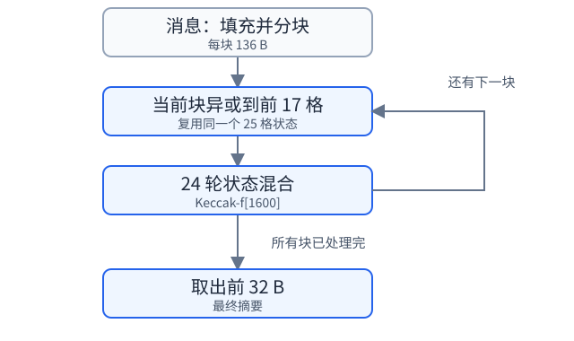

**先补齐消息。** 实现先追加后缀 `0x06`，再补零，使总长度达到 $136$ B 的整数倍，最后把末字节的最高位设为 $1$，即与 `0x80` 合并。如果原消息在当前块中已经占用 $135$ B，后缀正好落在块末，得到 `0x86`；如果消息恰好占满 $136$ B，则必须再增加一个完整的填充块。本方案采用 FIPS 202 规定的 SHA3-256；通常被称为 Keccak-256 的实例使用不同的填充后缀。

**每块执行 $24$ 轮混合。** 这套状态变换称为 Keccak-f[1600]，其中 $1600$ 是状态的位数。每一轮依次执行五个步骤：

| 步骤 | 作用 |
| --- | --- |
| $\theta$ | 计算各列的异或值，并把相邻列的信息混入当前列 |
| $\rho$ | 在每个格子内部循环移动比特 |
| $\pi$ | 把整个格子移动到新的坐标 |
| $\chi$ | 根据同一行中相邻格子的比特，决定当前格子的哪些比特需要翻转 |
| $\iota$ | 把本轮常数异或到坐标 $(0,0)$ 的格子 |

Python 整数可以超过 $64$ 位，因此循环移位和按位取反后都要通过掩码，只保留所需的低 $64$ 位。所有消息块吸收完毕后，实现按原来的格子顺序把状态写回字节，并取前 $32$ B 作为摘要。

对于长度为 $\ell$ B 的消息，本实现执行状态置换的次数为

$$
\left\lfloor\frac{\ell}{136}\right\rfloor+1.
$$

因此，$135$ B 消息只需一次置换，$136$ B 消息则需要两次，这也解释了性能曲线在这一边界附近的耗时变化。真实叶子输入除消息外有 $57$ B 固定开销，内部节点输入固定为 $65$ B，最终承诺输入固定为 $41$ B；所以，即使哈希调用次数相同，较长消息仍可能需要更多时间。[FIPS 202](https://csrc.nist.gov/pubs/fips/202/final) 给出了算法规范和安全工作量说明。

## 实现正确性基线

五个基干测试承担实现验收。手写 SHA3 保留 140 条 NIST CAVP 固定向量与 abc 样例，涵盖填充边界和多块吸收。树测试取 $n=1,3,8,9$，分别检查单叶、占位、完整二叉树和跨二次幂，并将生产根与不调用生产 helper 的独立递归规格比较。

每种树形开封首、中、末位置并验证完整开封。另一项测试只保留消息、nonce、兄弟摘要、公开根以及完整开封消息被修改的代表性情况。最后让三类协议对象各往返一次，并检查公开验证的字节入口。这些检查把哈希标准、树规格和公开接口连接起来，提供实现正确性的基线。

新增的批量测试覆盖相邻和跨子树共享、全部位置、字节往返及缺少/多余摘要的拒绝，根仍与独立规格比较。

实现集中在 `correctness/test_correctness.py`，NIST 向量位于 `correctness/data/sha3_vectors.json`。分布与开销实验分别由 experiments/ 下的两个脚本运行。

## 密码分布实验

单叶 A/B/C/D 保留为密码学原理演示，树级 A′/B′/C′/D′ 是本方案的主要实验。A′ 沿用原 E 的数据和实现；B′ 检查邻居开封后的公开视图，C′ 实际恢复被孤立的目标，D′ 构造弱化承诺的冲突开封。所有哈希仍使用手写 SHA3，原始样本、公开材料和攻击见证保存在 distribution.json。默认种子 20261012，各类依次加 0–7；种子只控制实验输入。

### 单叶原理演示

#### 实验 A：单叶commit雪崩效应分析

固定 $n=8,i=3$，消息与 nonce 均为 32 B。分别采集两组各 10,000 对输入，每对只改变消息或 nonce 的一个随机位；比较两个叶摘要的汉明距离，并统计每个输出位的翻转频率。这里的单叶 commit 指随机化叶摘要。

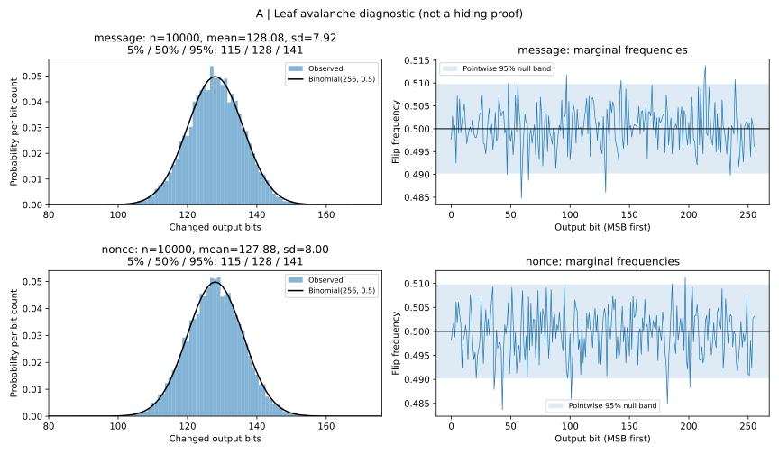

消息位改变后的平均距离为 128.08 位，nonce 位改变后为 127.88 位，标准差分别为 7.92 和 8.00。这与 $\operatorname{Binomial}(256,1/2)$ 的均值 128、标准差 8 相吻合：一次局部输入变化通常改变约一半输出位，而距离集中在 128 周围。图内的 5%、50%、95% 分位数展示这种集中程度，右侧频率曲线则展示扩散覆盖各个输出位。

这说明本实现中的消息和 nonce 都充分参与了叶摘要的混合。对于 Binding，消息改动会产生新的叶摘要，随后由实验 A′ 展示它如何传到承诺；对于 Hiding，nonce 的变化能够重新随机化摘要的外观，实验 B/C 进一步观察这种作用如何隐藏低熵类别、扩大猜测空间。

#### 实验 B：低熵输入类别无偏测试

对单字节消息 0/1 各使用 10,000 个新 nonce，对两种情况下的摘要**逐位**检查该位为 1 的频率，计算两种情况的频率差。

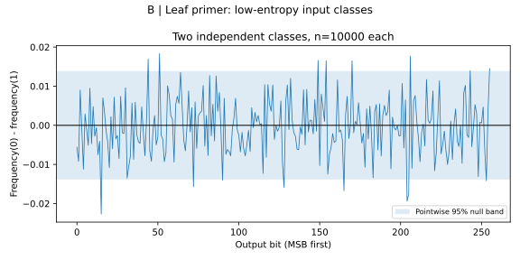

频率差围绕零波动，图中的逐位参考带给出抽样尺度。这个演示说明，整理来说，输出的每一位上被抹去了简单的消息类别偏向；树根和开封材料是否继续呈现这种行为，由 B′ 观察。

#### 实验 C：（小模型中的）抗穷举攻击性

十个候选数字配合只有 $t=4,6,8,10$ 个未知位的 nonce，每档搜索 20 个目标。单图保留首次恢复查询数的箱线分布和均值，完整样本继续保存。

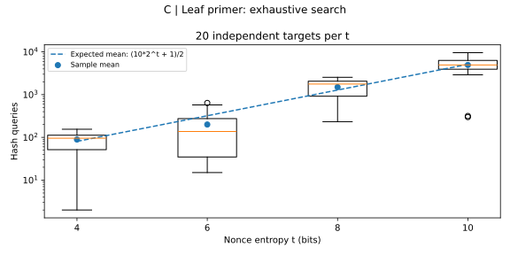

候选空间为 $M=10\cdot2^t$，均匀目标的平均查询数为 $(M+1)/2$。每多一个未知位，搜索空间约翻倍；固定候选预算 $q$ 下，恢复概率为 $\lfloor q\rfloor/M$。树上攻击如何使用这个空间、真实验证会多做多少哈希，由 C′ 量化。

#### 实验 D：投影摘要碰撞测试

保留前 $b=8,12,16,20$ 位叶摘要，每档搜索 100 次首次碰撞，用一幅图比较实测分布和生日模型。

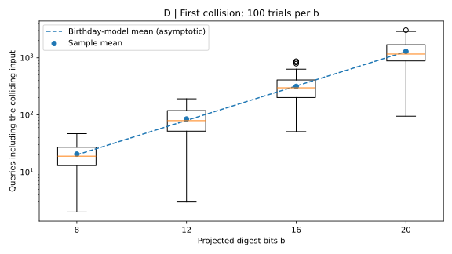

平均查询数为 20.63、84.83、315.57、1293.20，呈现约 $2^{b/2}$ 的增长。输出每增加 4 位，典型成本大约乘 4；D′ 将同一原理连接到“同一公开承诺接受两个不同消息”的具体开封事件。

### 树级方案实验

#### 实验 A′：树结构篡改传播分析

构造 $n=8,32,257,1024$ 的树，每规模在同一棵树上对消息改一位、nonce 改一位各采样 100 条路径。保持兄弟摘要不变，同时重算原路径和修改后的路径，记录叶、各父层、树根及最终承诺的汉明距离；每规模每类首例还重建全树核对节点变化。

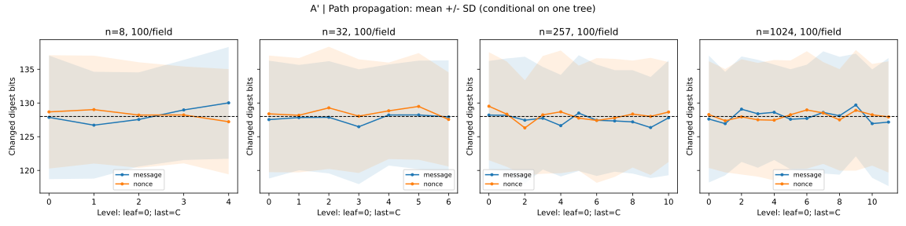

横轴值中，$0$ 是叶节点，$h=\lceil\log_2 n\rceil$ 是树根，特别地用 $h+1$ 表示最终承诺；曲线表示均值，色带表示样本标准差。各层平均距离持续围绕 128 位，而不是随深度逐层增加。每层哈希都把输入差异重新扩散到一个固定的 256 位输出，所以树深增加的是传播步骤，摘要差异保持在同一个统计尺度。

八次整树核对均显示，每层只有一个节点会改变，其它子树保持原值，局部修改沿唯一祖先路径到达最终承诺。这反映了单项验证只需 $O(\log n)$ 个兄弟摘要的结构原因。对于 Binding，攻击者要保留原承诺，就必须让这条变化链在某处与原链汇合（该处纵轴为 $0$），从而产生碰撞；扩大树规模仅改变路径长度，哈希输出宽度才决定每次汇合的密码学门槛。

#### 实验 B′：邻居开封后的隐藏性观察

> **场景：** 现把位置 2 的消息藏起来，但公开位置 3。为了验证位置 3，证明必须交出它的兄弟摘要——恰好是位置 2 的完整叶哈希。现在攻击者握着这个哈希，要判断位置 2 是“0”还是“1”；攻击者仍没有位置 2 独立的 32 B nonce。本实验检查的正是这种比只公开树根更强的观察条件。

取 $n=3,8,9$，每规模对 0/1 两类各建 1,000 棵树。两个挑战**只改变一条目标消息为 0/1**；其余消息和该对中的其它 nonce 相同，目标 nonce 分别新采样；对于所观察的摘要，对其每一位，计算目标消息为 0/1 的两类情况下该位等于 1 的频率差。$n=8,9$ 时目标/邻居为 2/3，$n=3$ 时为 0/1；邻居始终是真实叶。

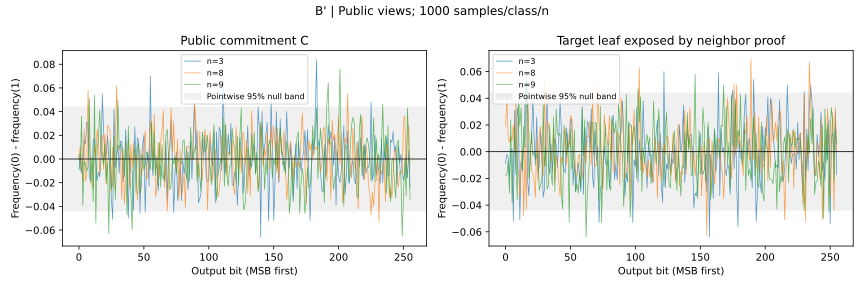

左图中，所观察的摘要是最终承诺 $C$；右图中，观察从邻居的证明中读出的目标叶摘要。每条记录保存 $C$、邻居消息和完整邻居证明；程序核对证明的首个兄弟确实等于目标叶。两类逐位频率差的波动尺度约为 $1/\sqrt{s}$，所以树级图的参考带随各类样本量设定。

这把 Hiding 放进实际公开接口：开封邻居提供了更多材料，但没有公开目标 nonce。树根合成和合法证明中的摘要都参与观察，避免只从单个叶的扩散推断整个公开视图。图比较的是这些逐位指标，安全模型中的未知 nonce 则解释了攻击者为何仍要扩大猜测空间。

#### 实验 C′：其它叶全部开封后的目标恢复

> **场景：只剩一个秘密。** 整棵树已经建好，公开承诺也发出去了，除了目标以外的所有消息都合法开封。目标被孤立，攻击者拿着承诺 $C$ 和所有其它开封材料开始枚举。本实验让攻击者分别走完整验证路径、直接匹配已暴露的目标叶摘要，比较这两种真实攻击。

取 $n=3,8,9$、$t=4,6,8$，每组合 8 个独立目标。目标候选为十个数字，nonce 字段仍为 32 B，仅低 t 位未知。程序从邻居的公开证明取得目标叶摘要，从公开邻居消息及 nonce 计算另一侧叶，再组装目标的兄弟路径；攻击入口没有取得目标私有 nonce。

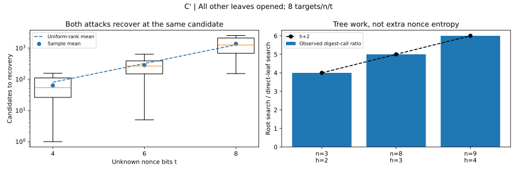

走根搜索逐候选调用正式 verify；直接搜索只计算叶摘要。两种算法都实际运行，并核对在同一个候选处恢复原消息与 nonce。左图汇总首次恢复候选数，理论均值仍为 $(10\cdot2^t+1)/2$：公开其它叶没有改变目标 nonce 的未知位数。

右图比较包装 H 得到的实际调用数，走根搜索与直接叶匹配之比为 $h+2$，三种树形分别为 4、5、6。这个差异来自每个候选的叶哈希、h 层父节点和最终封装。Hiding 的指数门槛来自 nonce 熵；增加树深只提高走根这条搜索路径的工作量，观察者取得目标叶摘要后还能选用较便宜的直接匹配。

每组合采用 8 个目标以控制当前 Python 的哈希预算，原始目标和全部其它开封材料均保留。未来 C 语言后端可扩大目标数及 t，进一步观察恢复率的预算曲线。

#### 实验 D′：投影下的公开承诺碰撞测试

> **场景：** 固定同一个位置、其它消息和所有 nonce，只改变消息。把最终公开承诺缩成前 $b$ 位。攻击者锁定同一个位置，在不改变其他节点的情况下，寻找两个完全不同的消息（产生两份仅消息不同的 Openning），使其得到相同承诺前缀。实验仅弱化了公开承诺 $C$ 的宽度，各节点内部仍计算完整 SHA3-256。

取 $n=3,8,9$、$b=8,12,16$，每组合 12 次搜索。候选消息递增，保证消息不同；复用已保存的兄弟摘要，每次只重算目标路径。公开教学承诺为 $(n,\operatorname{prefix}_b(C))$，教学验证器由完整开封重建整树后比较这个前缀。

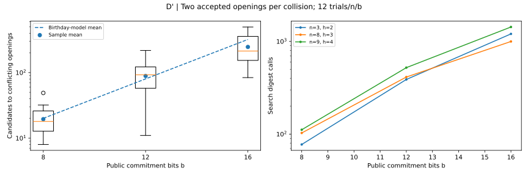

每次碰撞保存两份完整的字节开封和两个完整 $C$，并实际核对：两份开封都被同一个短承诺接受；若恢复正式 256 位承诺，第二份开封被 verify_all 拒绝。这样，碰撞记录直接对应 Binding 的失败事件，而不仅是一对抽象摘要。

本次 $n=8,b=16$ 的一条实际记录在第 175 个候选处发现冲突：“141”和“174”得到相同的 16 位公开承诺，两份完整开封都被教学验证器接受。完整的 256 位 $C$ 不同，正式验证器可以区分这两笔欠款；两份字节开封保留在 JSON 中。

左图观察首次冲突开封的候选数，增长尺度仍为 $2^{b/2}$；右图观察实际搜索哈希数，每个候选消耗 $h+2$ 次哈希。输出宽度决定生日攻击门槛，树深决定重算路径的成本。本实现保留 256 位 $C$，前面的碰撞归约把改口门槛连接到完整哈希输出。

## 实现开销实验

P1–P3 均测量当前手写 Python 后端。每项操作预热一次，用 pilot 校准 batch 至约 0.2 s，再采集九组“秒/调用”；图展示中位数和四分位区间，JSON 保留全部九组值和 batch。输入及证明准备在计时区间外，哈希工作量在单独一次调用中统计。

### 性能实验 P1：SHA3 分块边界开销

对预先构造好的全 a 字节串计算 32 B 摘要，长度取 0、32、64、4096 B，以及 130–142、266–278 B 两个逐字节窗口。计时包含填充、吸收、置换和输出。

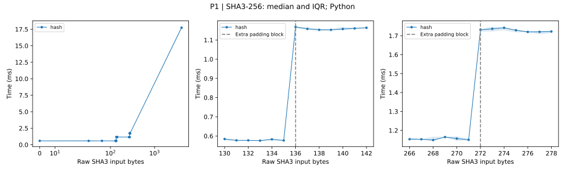

135→136 B 时，中位耗时从 0.577 ms 增至 1.168 ms，约翻倍；271→272 B 时从 1.150 ms 增至 1.731 ms，约增加一半。两处分别对应置换次数 1→2、2→3，原因是输入恰好占满 136 B 的 rate 后，填充还需要一个块。

长输入的工作量为 $\lfloor\ell/136\rfloor+1$ 次置换；4096 B 需要 31 次，中位耗时为 17.740 ms。局部阶梯与全局线性增长共同说明：决定哈希成本的是处理块数。这为 P3 中叶编码跨块后的增长提供了底层解释。

### 性能实验 P2：树规模对建树、开封与验证的影响

每条消息为 32 B，前 8 B 编码位置、后 24 B 为 x。规模取 $n=1$ 及 $2^d-1,2^d,2^d+1$，其中 $d=3,5,7,8,9,10,11,12$，最大为 4097；每棵树预先生成首、中、末及至多 13 个随机位置的证明，计时时循环使用。

commit 包含消息规范化、nonce 生成、全部哈希和树层保存；open 在已有树上读取消息、收集路径并构造证明；verify 使用已有证明重算叶和路径；verify_all 重建全树。验证使用对象入口，open 返回已有消息引用与证明。

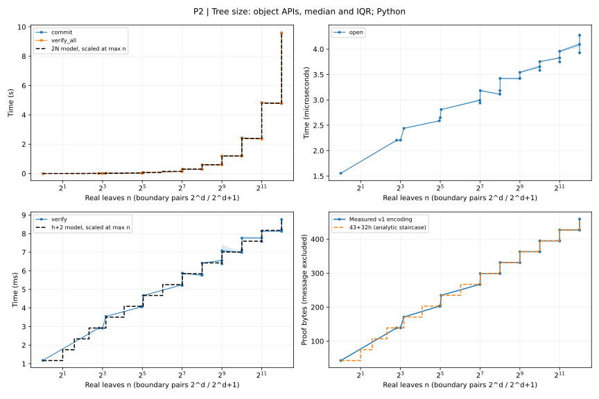

commit 和 verify_all 都需 $2N$ 次哈希，因此随补齐容量 $N$ 增长，整体为 $O(n)$。1024→1025 时建树从 1.196 s 增到 2.435 s；4096→4097 时从 4.780 s 增到 9.592 s。两次相邻点都使 $N$ 翻倍，揭示了“只多一条消息却明显变慢”的原因。完整验证曲线与建树接近，也体现了两者相同的哈希工作量。

open 和 verify 的增长缓得多：只处理深度 $h=\lceil\log_2 n\rceil$ 的一条路径。4096 叶时，open 约 3.93 μs，verify 约 8.21 ms；前者只收集已有兄弟摘要，后者执行 $h+2$ 次哈希。这说明本实现把主要密码计算放在建树和验证中，已有树上的证明生成很便宜。

证明编码恰为 $43+32h$ B，规模翻倍仅多一个 32 B 兄弟摘要。树使完整列表的绑定承诺可以通过对数大小的材料验证一个位置，而不必把整组消息交给验证者。图中的时间参考线按最大规模归一化，字节阶梯则由编码公式直接给出。逻辑存储为 $(2N-1)\cdot32+32n+\sum_i|m_i|$ B，计入节点摘要、nonce 和消息载荷。

### 性能实验 P3：消息长度对建树、开封与验证的影响

固定 $n=N=32$，消息为全 x 字节串。全局长度取 0、16、32、64、128、256、512、1024、4096 B，局部逐字节采样 70–86、206–222 B。叶输入比消息多 57 B，所以新的填充块出现在消息长度 79、215 B。

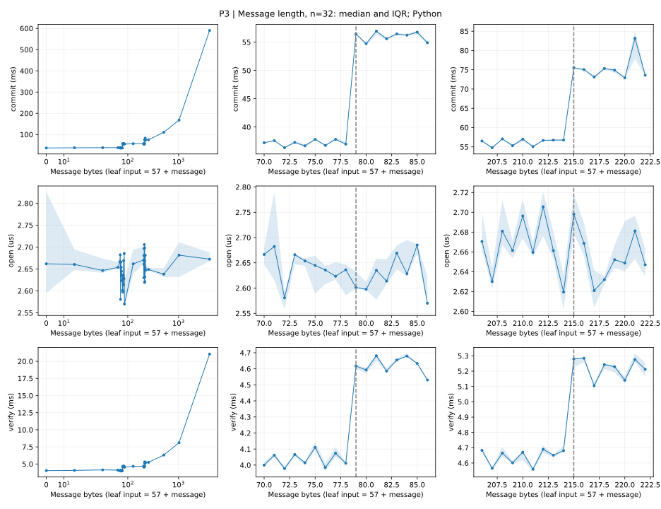

78→79 B 时，commit 从 36.98 ms 增至 56.44 ms，verify 从 4.01 ms 增至 4.62 ms。若叶输入需 $p=\lfloor(57+|m|)/136\rfloor+1$ 次置换，整棵树需 $32p+32$ 次，单项验证需 $p+6$ 次。跨第一个边界时，前者从 64 增为 96，后者从 7 增为 8；实测分别约增加 53% 和 15%，对应两种操作中叶哈希占比的差异。

214→215 B 时，commit 从 56.76 ms 增至 75.52 ms，verify 从 4.68 ms 增至 5.28 ms；两条曲线再次按各自新增的置换量抬升。长消息主要增加叶摘要的计算成本，固定长度的父节点成本保持不变，因而建树对消息长度更敏感。open 在这些长度下约为 2.6–2.7 μs，反映它读取已有消息引用和路径的接口行为。

这把安全设计与实现成本联系起来：nonce、数量、索引和长度字段共同构成无歧义的随机化叶输入，其 57 B 固定开销也决定了具体的分块边界。当前 4096 B 消息下，建树约 590.32 ms、单项验证约 21.06 ms，仍保持全树处理与单路径处理的工作量差异。

### 性能实验 P4：共享路径的证明大小与计算成本

固定一棵 4096 叶的树，每条消息 32 B。开封数量 k 从 1 增至 4096，比较随机起点的连续区间、均匀分散和随机无重复位置。连续与随机每档采集 300 个实际证明结构，分散位置只有一个确定结构；完整集合端点三类共用一次。

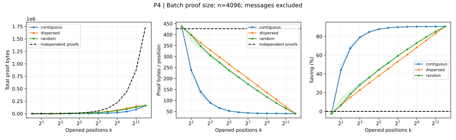

大小以真实批量编码和单点编码公式比较，均不含消息与公共承诺。连续位置更容易共享父节点，分散位置需要更多边界材料；批量证明中 k 个索引和 nonce 始终逐项保留。k=1 时批量编码多 10 B，k=4096 时没有兄弟摘要，但仍有 163,853 B 的索引、nonce 和字段，单点证明为 1,748,992 B。

读大小图时，左图纵轴为一个 k-batch 证明的总字节，中图纵轴为每个开封位置分摊的字节，右图纵轴为相对单点方案的节省比例。单点证明逐份重复携带路径，每位置大小保持不变；批量方案随共享增加而降低每位置成本。连续位置最早获得这种收益。只有一个位置时尚无共享，批量格式的额外字段反而略大；开封全部位置后，三种分布成为同一个集合，曲线汇合。

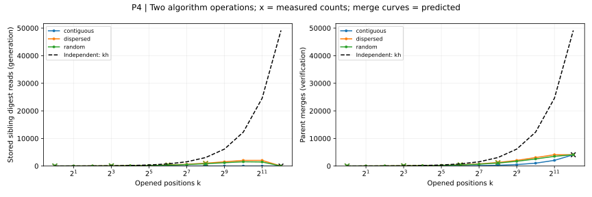

左图统计证明时的 `level[position]` 访问次数，每取一次已保存兄弟摘要就记一次，包含单点证明重复取同一位置的情况；右图统计合并函数 `_parent_hash` 调用次数。这两个指标分别解释材料取用和共同祖先的重复计算。结构分布曲线给出中位数与四分位范围，父合并曲线由实际结构预测，叉号为真实执行计数。

单点方案的两项次数都是 kh；批量分别为 s 与 $k+s-1$。完整端点从 49,152 次重复摘要取用降为零，从 49,152 次父合并降为 4,095 次；验证总哈希则从 57,344 次降为 8,192 次。读取为零只表示无须携带边界摘要，索引、nonce 和集合处理仍有成本。

操作量图中，单点方案随 k 线性增加，因为每份证明都重新走完整路径。批量方案只处理一次共同祖先。兄弟摘要读取曲线可以先升后降：小集合扩张时会接触更多边界，但集合接近整棵树时，原先需要证明提供的边界节点已能从已开封叶子重建，最终无须读取任何兄弟摘要。这不是验证工作归零；右图仍需合并整棵树的 4,095 个父节点。

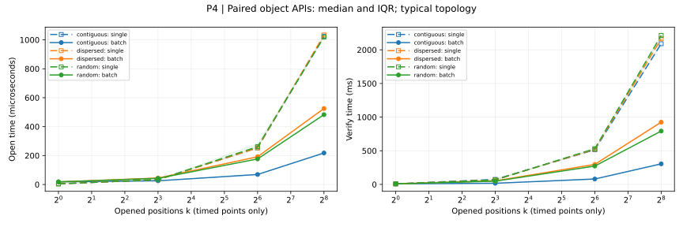

计时比较 k 次 open 与一次 open_many、k 次 verify 与一次 verify_many，使用对象入口，排除建树、编码和准备证明。连续与随机在 300 个结构样本中选择中位兄弟数的固定输入，分散使用确定输入；选择发生在计时之前。默认只计时 k=1、8、64、256，小组九批，大 k 三批，图上只画实测点及批间 IQR。

读时间图时，蓝、橙、绿分别表示连续、分散、随机位置；同色的长虚线与空心方块是单点证明，实线与实心圆是批量证明。比较同色两条线即可看出相同位置集合的批量收益。横轴按 2 的幂刻度排列开封数量，左图单位是微秒，右图是毫秒，两图的高度不能直接比较。阴影是重复计时的四分位范围，表示运行波动，而不是位置分布的差异；连线只连接四档实测点。

右图中，三条单点验证曲线接近重合，因为同样的 k 和树高意味着近乎相同的哈希工作量。批量验证则随位置分布分开：连续位置共享低层父节点最多，曲线最低；分散位置更晚汇合，需要重建更多父节点，曲线最高。随着 k 增加，共享路径使批量曲线与单点曲线拉开距离。左图展示的是已有树上的材料读取和对象构造，不重新计算哈希，所以耗时远小于验证；批量收益来自少取重复摘要、少创建单点证明对象，而非加速 SHA3。k=1 没有路径共享，不能指望批量入口本身带来加速。

摘要读取减少与父合并减少解释共享收益；集合和排序成本也包含在真实时间中，所以生成开销不会严格按材料数量缩放。大 k 的大小与操作量继续展示，完整端点额外只执行一次计数；`--large-timing` 才开启更大位置集合的重复计时。原始结构、真实计数和时间分别保存在 batchproof-performance.json。

本次 k=256 时，连续、分散、随机位置的批量验证中位耗时分别为 305.52、924.51、792.91 ms，对应单点验证为 2090.58、2164.23、2213.96 ms，约加速 6.84、2.34、2.79 倍。连续位置共享更多内部节点，因此验证收益最大；分散与随机位置保留更多边界，仍能消除上层的重复计算。同三组批量开封约为 0.218、0.525、0.483 ms，单点开封约为 1.02–1.03 ms，反映一次共享构造减少了重复材料读取和多个证明对象的创建。

### 结果与复现

八个分布实验及四个性能实验生成数据与 SVG，原始数据保存在 results/ 下，运行和重绘命令见 [README](../README.md)。默认参数覆盖当前 Python 后端可行的范围；--quick 用于开发检查，--from-json 直接重绘保存的样本。

各实验类的 #! 注释注明参数范围。未来自写 C digest 通过 NIST 和协议输入对照后，实验 A/B 可增至每组 100,000 个样本、C 可扩至 14/16 位、D 可扩至 24/28 位、A′ 可扩至 65536 叶。性能实验可进一步扩大树和消息长度，并保留 Python/C 的重叠区间；C 语言后端仍留作 TODO；batch proof 已实现。

### TODO（可选）：用 C 语言写 SHA3 后端，从而扩大实验规模

当前代码的性能受限，不便对稍大的 n 开展实验。主要的瓶颈是**哈希置换**而非树的位置管理。本机以 256 条 32 B 消息建树的 `cProfile` 剖析记录为例，总耗时约 0.422 s，512 次 `sha3_256_digest` 累计占 99.3%，其中 `_keccak_f1600` 占总耗时 94.2%。这两个比例是包含关系，不能相加。这个结论针对建树和密码验证（开封只读取已保存的树节点，不调用哈希，上述比例无意义）。

Keccak 每次置换执行 24 轮，每轮反复处理 25 个 64 位字。当前 Python 版本每次置换调用 720 次 `_rotl64`，上述建树共调用 368,640 次。移位、异或、掩码在 Python 中是解释器执行的整数对象运算，伴随临时对象、函数调用和多层列表索引；每轮还创建中间数组。在 C 中，这些工作可以用固定大小的 `uint64_t` 数组和编译后的机器整数运算完成，省去逐项解释和大量对象操作。树越大，叶哈希与父哈希越多，这个常数开销便被反复放大。

> TODO：自写完整的 C `digest(bytes) -> 32 B` 后端，包含 SHA3 填充、吸收、24 轮置换和摘要输出；每个摘要只跨一次 Python/C 接口，不把每轮或每次旋转拆成跨语言调用。继续保留 Python 实现作为参考，不调用现成哈希库。先通过现有 NIST 向量，再对叶、父节点、承诺等实际编码输入逐字节对照，之后接入现有 hasher 入口；不改变树结构、协议字节或验证规则。

C 后端改变的是相同算法的执行成本，不改变 Binding/Hiding 的参数或依据。完成后记录后端与编译选项，可在相同输入规模上实测比较 Python/C，再采用 C 后端在各项实验中扩大树规模和分布样本量。P4 的摘要读取次数、父合并次数及证明字节数应理应保持不变。

## 组员与实现来源

组员信息按要求暂留空白，提交前应填写实际的 $2$–$3$ 名成员及其分工。

| 姓名 | 学号 | 实际分工 |
| --- | --- | --- |
|  |  |  |
|  |  |  |
|  |  |  |

SHA3 核心沿用组员提供的手写版本，并依据 FIPS 202 进行核对和修订。树算法、协议编码、测试和基准均在本项目中实现，没有调用现成的哈希或 Merkle Tree 实现；外部标准与测试向量只用于定义算法和校验结果。原始编写过程由组员据实记录，早期材料可以通过 Git 历史追溯。

AI 辅助完成审查、方案与代码修订及文档编写。小组成员需要填写实际分工，并负责理解和展示最终方案。
